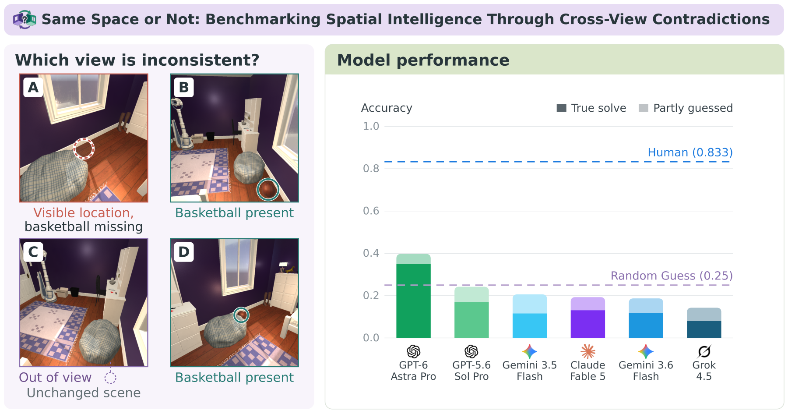
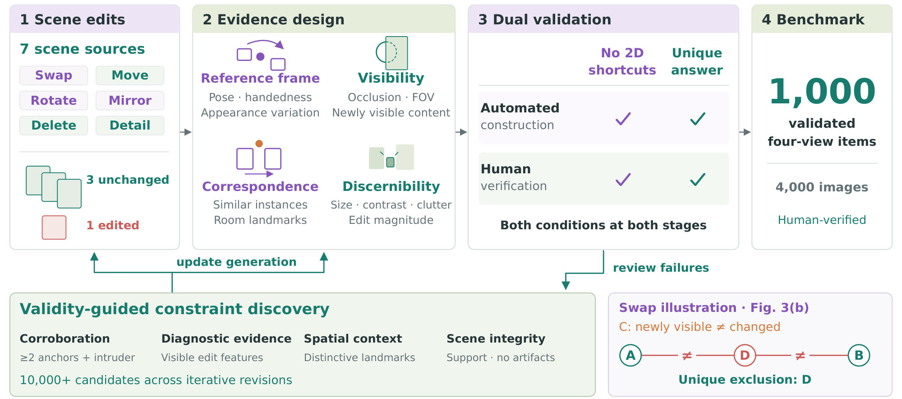

<p align="center">
  
</p>

# Same Space or Not (SSoN)

**Benchmarking Spatial Intelligence Through Cross-View Contradictions**

[Project page](https://sson.aisexam.com/) · arXiv: **Coming soon** · [Dataset](https://huggingface.co/datasets/HuiziCao/SSoN) · [Checkpoints](https://huggingface.co/HuiziCao/SSoN-Qwen2.5-VL-7B-LoRA)

**Four views. One contradiction.** SSoN tests whether a model can identify the view that cannot belong to the same unchanged 3D scene as the other three, and explain the contradiction using cross-view evidence.



SSoN contains **1,000 questions**, **4,000 images**, **seven scene sources**, and **six edit categories**. Humans achieve 83.3% answer accuracy, compared with 39.7% for the strongest evaluated VLM. Requiring a factual, sufficient explanation reduces that model's score to 34.9%.

This repository provides the **Qwen2.5-VL-7B fine-tuning and local evaluation pipeline**, including fixed splits, answer and rationale supervision, model responses, and result analysis.

## Construction framework



Each question pairs three views of an unchanged scene with one view of an edited variant. Evidence design and human verification establish a unique, attributable contradiction while screening out simple visual shortcuts.

## Resources

| Resource | Location |
| --- | --- |
| Project page | [sson.aisexam.com](https://sson.aisexam.com/) |
| Paper (arXiv) | Coming soon |
| Dataset on Hugging Face | [HuiziCao/SSoN](https://huggingface.co/datasets/HuiziCao/SSoN) |
| Checkpoints on Hugging Face | [SSoN-Qwen2.5-VL-7B-LoRA](https://huggingface.co/HuiziCao/SSoN-Qwen2.5-VL-7B-LoRA) — answer and rationale-and-answer adapters |

## Quick start: reproduce the reported results

Run from the repository root with **Python 3.10+**. The included model responses are sufficient for this step; only the Python standard library is required.

```bash
python scripts/reproduce_results.py --output outputs/reproduced_summary.json
```

| Supervision | Correct | Accuracy |
| --- | --- | --- |
| Zero-shot | 44 / 201 | 21.89% |
| Answer | 67 / 201 | 33.33% |
| Rationale and answer | 84 / 201 | 41.79% |

The script reparses the saved responses and computes answer accuracy, category breakdowns, confidence intervals, cyclic-order diagnostics, and paired comparisons. These fine-tuning results use **201 held-out questions**; the teaser reports the separate full-benchmark evaluation.

## Installation

For training or model inference, use a CUDA GPU with BF16 support. Create a Python environment and install a CUDA-compatible PyTorch build matching `requirements.txt`, followed by the remaining dependencies.

```bash
python -m venv .venv
source .venv/bin/activate
python -m pip install -r requirements.txt
python scripts/check_environment.py
```

The training configurations use an optional variable-length vision-attention optimization. If it is unavailable in your environment, add `--standard-sdpa` to the experiment commands. GPU memory usage depends on image sizes and the software stack.

## Prepare the data

Download the SSoN question bank and generation metadata from the dataset resource above. See [Data format](docs/data_format.md) for the directory structure and manifest fields.

```bash
export ODDOUT_BANK=/absolute/path/to/BANK_dataset
python build_manifest.py --bank "$ODDOUT_BANK" --out data/manifest.jsonl
python prepare_official_data.py --manifest data/manifest.jsonl --bank "$ODDOUT_BANK" --out data
```

If the dataset already includes a unified manifest, pass it directly to `prepare_official_data.py` and skip `build_manifest.py`.

Preparation uses the fixed question IDs in `data/splits/` and produces:

| File | Content |
| --- | --- |
| `data/train.jsonl` | 700 training questions |
| `data/val.jsonl` | 99 validation questions |
| `data/test.jsonl` | 201 held-out questions |
| `data/train_aug.jsonl` | 2,800 examples with balanced answer positions |
| `data/official_preparation.json` | Preparation settings, counts, and input/output fingerprints |

Related scenes remain within a single split. `prepare_data.py` is available for exploratory split generation; the reported experiment uses `prepare_official_data.py` and the fixed lists.

## Training and evaluation

Run the zero-shot baseline and the two supervision conditions:

```bash
python scripts/run_experiment.py --config configs/baseline.json --stage eval
python scripts/run_experiment.py --config configs/answer.json
python scripts/run_experiment.py --config configs/rationale.json
```

Each training run selects its best adapter on the validation set, then evaluates it on the held-out test set. Both conditions use three epochs, seed 1, and rank-16 LoRA. The vision encoder and merger remain frozen. Detailed settings and selection rules are in [Training and evaluation protocol](docs/protocol.md).

The runner reads `ODDOUT_BANK`; alternatively, pass `--bank /absolute/path/to/BANK_dataset`. Add `--dry-run` to inspect the generated commands before execution.

To resume training from a saved Trainer checkpoint:

```bash
python scripts/run_experiment.py --config configs/answer.json --stage train --resume
python scripts/run_experiment.py --config configs/answer.json --stage eval
```

Use a new output directory for a new experiment or changed settings:

```bash
python scripts/run_experiment.py --config configs/answer.json --run-dir outputs/answer-new --eval-out outputs/eval/answer-new.jsonl
```

### Evaluate a downloaded adapter

After preparing the data, point `--adapter` to the local folder containing `adapter_config.json` and `adapter_model.safetensors`:

```bash
python scripts/run_experiment.py --config configs/answer.json --stage eval --adapter /path/to/answer-adapter --eval-out outputs/eval/answer-adapter.jsonl
python scripts/run_experiment.py --config configs/rationale.json --stage eval --adapter /path/to/rationale-adapter --eval-out outputs/eval/rationale-adapter.jsonl
```

Both adapters use `Qwen/Qwen2.5-VL-7B-Instruct` as the base model. See [Checkpoints](docs/checkpoints.md) for their configuration and local layout.

## Analyze results

```bash
python report.py --before outputs/eval/base_cyclic4.jsonl --after outputs/eval/answer_cyclic4.jsonl --by dataset tier letter
python report.py --before outputs/eval/answer_cyclic4.jsonl --after outputs/eval/rationale_cyclic4.jsonl --by dataset tier letter
python make_tables.py --split data/test.jsonl --all-views "Zero-shot=outputs/eval/base_cyclic4.jsonl" "Answer=outputs/eval/answer_cyclic4.jsonl" "Rationale and answer=outputs/eval/rationale_cyclic4.jsonl"
```

Headline accuracy uses the original panel order and the strict final-line JSON parser. Four cyclic orders provide an additional diagnostic, with bootstrap intervals computed over questions.

`analyze_rationale.py` and `eval_rationale_intervention.py` provide auxiliary rationale diagnostics. The paper's **True solve** metric uses human-adjudicated explanations and is distinct from these diagnostics. The `ts` field in saved evaluation records is a timestamp.

## Repository guide

| Path | Purpose |
| --- | --- |
| `assets/` | Project logo, teaser, and construction framework |
| `configs/` | Baseline and fine-tuning settings |
| `data/splits/` | Official question IDs and split statistics |
| `common.py` | Prompts, image loading, supervision targets, and answer parsing |
| `train_lora.py` | LoRA training and validation-based checkpoint selection |
| `eval_local.py` | Generative and forced-choice evaluation |
| `report.py`, `make_tables.py` | Accuracy, confidence intervals, and paired comparisons |
| `results/` | Saved responses, training metadata, and reference results |
| `scripts/` | Experiment runner, environment checks, and result reproduction |
| `docs/` | Data, checkpoint, and experiment documentation |
| `tests/` | Data preparation, remapping, statistics, and run-consistency tests |

Run the CPU tests with:

```bash
python -m unittest discover -s tests -v
```

## Citation

Coming soon.

## License

This project is licensed under the [Creative Commons Attribution-NonCommercial 4.0 International License (CC BY-NC 4.0)](https://creativecommons.org/licenses/by-nc/4.0/). See [LICENSE](LICENSE) for the full terms.
